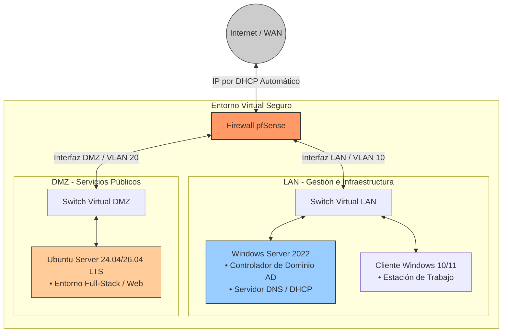

## 🌐 Diagrama de la Arquitectura de Red

Este diagrama representa la topología lógica del laboratorio virtual corporativo, detallando el aislamiento de las redes locales (LAN y DMZ) a través del firewall pfSense y la salida segura hacia Internet (WAN).



### 🛠️ ¿Cómo se adapta esto a tu documentación empresarial?

1. **Formato Profesional Nativo:** Al usar ````mermaid` dentro del `README.md`, GitHub lo convertirá en un gráfico interactivo muy limpio sin necesidad de que subas imágenes pesadas.
2. **Alineación con tu configuración:** Refleja con precisión tu entorno (pfSense como core, Windows Server 2022 gestionando la LAN, y tu máquina de desarrollo web en Ubuntu).
3. **Privacidad y Simulación:** Mantiene el enfoque de seguridad corporativa al no exponer datos reales de tu red física doméstica.

<FollowUp>
¿Quieres que agreguemos en el texto del `README.md` la **tabla detallada con las IPs falsas/simuladas** y los rangos de las subredes (VLANs) para que coincida exactamente con lo que tienes configurado en tu pfSense?
</FollowUp>
